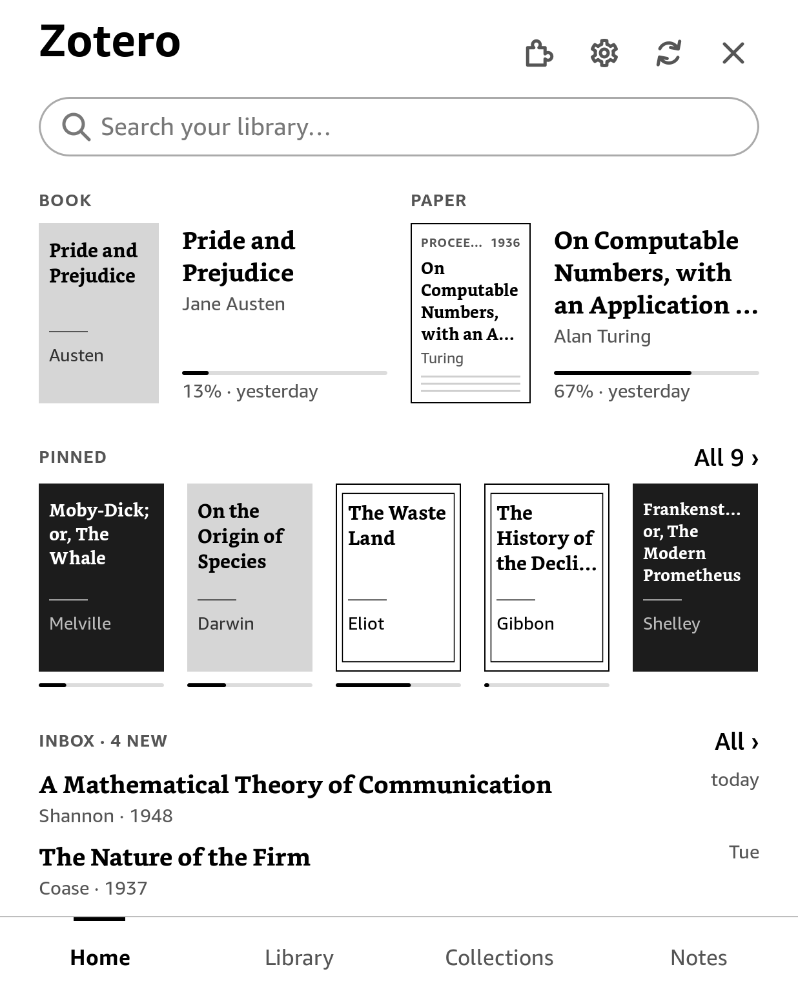

# Composing screens from primitives

App 0.12.0 adds small building pieces instead of finished widgets: `row` widths and alignment,
`spacer`, `box`, styled `text`, `cover`, `progress`, `item`, `grid` and `image`. A screen made from
them draws in the app's own type and greys on every Kindle; nothing here is a pixel. The recipes
below are the pieces [Reading Desk](../../sdk/examples/reading-desk/) is made of (see its
[`pieces.ts`](../../sdk/examples/reading-desk/src/pieces.ts)), simplified to stand alone. Each takes
`zk.Item`s from `zk.library`, and the one helper below, which turns an item into the reference
`zk.ui.item` and `zk.ui.cover` take. See
[Screens and entry points](screens.md) for the basics and the [reference](reference/README.md) for
every option.



```ts
const ref = (i: zk.Item) => ({ key: i.key, library: i.libraryId });
```

In the snippets, `item` is one `zk.Item`, `items` an array of them, and `byline(item)`, `authors`
and the like are strings you format yourself from the item.

## Text lines

A section label is small tracked capitals; a title is serif bold, cut at a number of lines.

```ts
const label = (t: string) => zk.ui.text(t, { style: "label", caps: true });
const title = (t: string, lines = 1) =>
  zk.ui.text(t || "Untitled", { font: "serif", weight: "bold", size: "body", lines });
const meta = (t: string) => zk.ui.text(t, { font: "sans", size: "small", tone: "secondary", lines: 1 });
```

## A list of text lines, one an item

`zk.ui.item` makes any piece an item: a tap opens it as the app opens items, a long-press shows the
item sheet. A word on the right takes `width: "auto"`, so the title gets the rest.

```ts
const lines = items.map((item) =>
  zk.ui.item(ref(item), zk.ui.row([
    zk.ui.column([title(item.title), meta(byline(item))], { gap: "xsmall" }),
    zk.ui.text("3 d", { width: "auto", font: "sans", size: "small", tone: "secondary" }),
  ], { align: "top", gap: "medium" })),
);
```

## A heading with a link

A label on the left and a link at its end: a text with an `id` is tappable and sends
`{ kind: "tap", id }`.

```ts
zk.ui.row([
  label("Pinned"),
  zk.ui.text("All 9 ›", { id: "all-pins", width: "auto", font: "sans", weight: "medium" }),
]);
```

In `onEvent`, `zk.ui.open("pins")` on that tap shows a screen of your own over Home; back returns.

## A one-row cover shelf

A grid with `columns: "auto"` fits as many tiles as `minWidth` allows; `rows: 1` draws one row and
never pages, so what doesn't fit isn't drawn.

```ts
zk.ui.grid(
  items.map((item) =>
    zk.ui.item(ref(item), zk.ui.column([
      zk.ui.cover(ref(item)),
      item.progress !== null && zk.ui.progress(item.progress),
    ]))),
  { columns: "auto", minWidth: "22%", rows: 1, gap: "medium" },
);
```

## A two-item pair

An item beside its cover. A `row` with `align: "stretch"` makes both children as tall as the row,
and a `spacer` in the stretched column pushes the bar and the meta line to the bottom, next to the
cover's foot. The cover takes `37%` of the width, the text the rest.

```ts
zk.ui.column([
  label("Reading"),
  zk.ui.item(ref(item), zk.ui.row([
    zk.ui.cover(ref(item), { width: "37%" }),
    zk.ui.column([
      title(item.title, 3),
      meta(authors),
      zk.ui.spacer(),
      item.progress !== null && zk.ui.progress(item.progress),
      meta("34%"),
    ], { gap: "xsmall" }),
  ], { align: "stretch", gap: "medium" })),
]);
```

Two of these side by side are two `column`s in a `row`, each with a `width` of `"50%"`.

## A segmented switch

A framed row of tappable boxes; the selected one is filled `"ink"` (its text is drawn white). A tap
sends the box's `id`. Only the frame is rounded: a rounded segment inside it would leave white
slivers at the frame's corners, and an unrounded one meets its border.

```ts
const segmented = (segs: { id: string; text: string }[], selected: string) =>
  zk.ui.box(
    zk.ui.row(segs.map((s) =>
      zk.ui.box(zk.ui.text(s.text, { align: "center", font: "sans", weight: "medium" }), {
        id: s.id, pad: "small", fill: s.id === selected ? "ink" : "none",
      })), { gap: "none" }),
    { border: "thin", radius: "small" },
  );
```

## Titles that line up: the bar-height slot

In a grid of covers, an item that was opened has a bar under its cover and one that wasn't has
none, so the titles below drift. Give every cell a slot of the same height: an empty box with
`pad: "xsmall"` is twice a bar's height and draws nothing, so the row is as tall with or without
the bar.

```ts
const barSlot = (item: zk.Item) =>
  zk.ui.row([
    item.progress !== null && zk.ui.progress(item.progress),
    zk.ui.box(zk.ui.spacer(), { pad: "xsmall", width: "1%" }),
  ], { gap: "none", align: "top" });
// cell: zk.ui.column([zk.ui.cover(ref(item)), barSlot(item), title(item.title)])
```

## On Home

A Home body's root column can trim instead of paging: `zk.ui.column(children, { fit: "trim" })`
draws the children in order while they fit, trims the first that doesn't (a grid to the rows that
fit) and drops the rest. Home never shows a pager. See
[Home, written by a plugin](concepts.md#home-written-by-a-plugin). Reading Desk is the full worked
example: a pair, a row of pins, the inbox or a passage, and a "Your desk" screen, all from the
pieces above.
